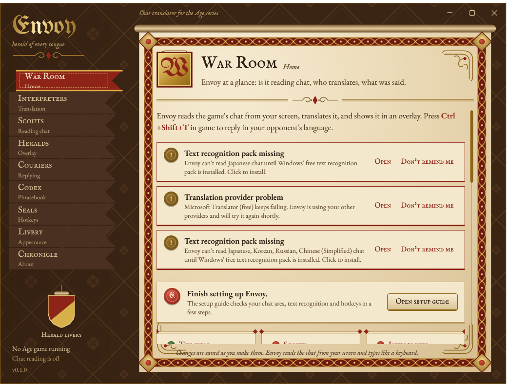
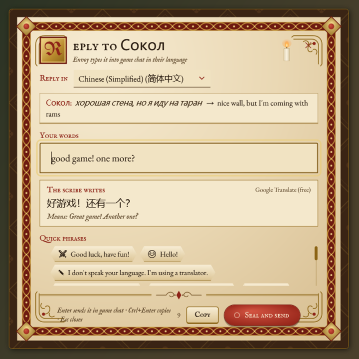
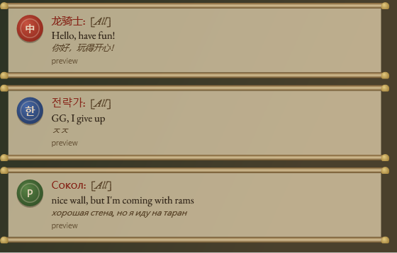
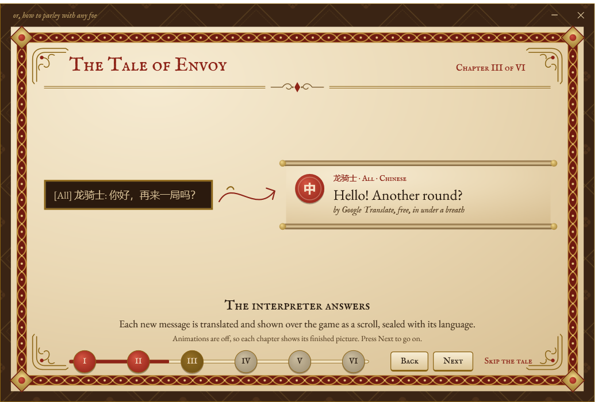
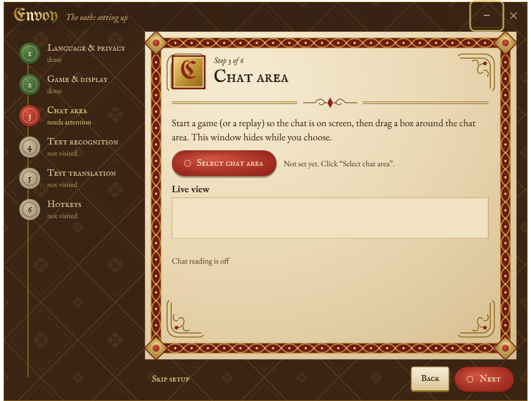
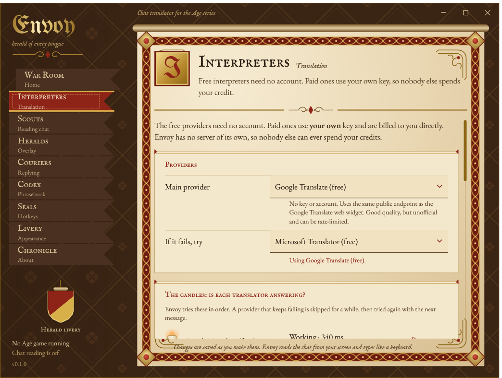

<p align="center">
  
</p>

<p align="center">
  <a href="https://github.com/PinnerSinner/Envoy/releases/latest"></a>
  <a href="#set-up"></a>
  <a href="#use-it-in-a-match"></a>
</p>

<p align="center">
  <a href="https://github.com/PinnerSinner/Envoy/actions/workflows/build.yml"></a>
  <a href="https://github.com/PinnerSinner/Envoy/releases/latest"></a>
  
  
  <a href="LICENSE"></a>
</p>

Ranked matchmaking puts you against players from everywhere. Envoy reads the chat on your screen, translates it
into your language and shows it over the game. Press a hotkey, type your reply in your own language, and Envoy types
it into the game chat in theirs.

<p align="center">
  
</p>

<table>
  <tr>
    <td width="50%"></td>
    <td width="50%"></td>
  </tr>
  <tr>
    <td></td>
    <td></td>
  </tr>
  <tr>
    <td></td>
    <td></td>
  </tr>
</table>

<p align="center"><sub>Screenshots of the real app, taken by CI on every build.</sub></p>

<p align="center">
  
</p>

<p align="center"></p>

<a id="download"></a>

Go to the **[latest release](https://github.com/PinnerSinner/Envoy/releases/latest)** and pick one file:

| | **Envoy-win-Setup.exe** (recommended) | **Envoy.exe** (portable) |
| --- | --- | --- |
| What it is | A small installer for your Windows account | One file, nothing to install |
| Admin rights | Not needed | Not needed |
| Updates | Downloads them in the background and asks before restarting | Tells you when a new version is out |
| Remove it | Settings › Apps › Envoy › Uninstall | Delete the file |

You need Windows 10 or 11 (64-bit) and an Age game running in **windowed or borderless** mode.

> [!NOTE]
> The first time you run it, Windows may say *"Windows protected your PC"* because releases are not code-signed
> yet. Click **More info**, check the name says Envoy, then **Run anyway**. Every release lists SHA-256 checksums
> so you can verify the file ([how](docs/installing.md#windows-smartscreen)).

<p align="center"></p>

<a id="set-up"></a>

Envoy opens a setup guide the first time it starts. It takes about two minutes.

<p align="center">
  
</p>

1. **Language and privacy.** Pick the language you read and write. Envoy shows exactly what leaves your PC (the chat
   text you want translated, sent to the translator you choose) and translates nothing until you agree.
2. **Game.** Set the game's display mode to **Borderless window**. Exclusive fullscreen hides the game from every
   other app, Envoy included.

   | Game | Where |
   | --- | --- |
   | Age of Empires IV | Settings › Graphics › Display mode › Borderless Window |
   | Age of Empires III: DE | Options › Graphics › Display mode › Borderless |
   | Age of Empires II: DE | Options › Graphics › Borderless Window |
   | Age of Mythology: Retold | Settings › Graphics › Borderless Window |
   | Age of Empires: DE | Options › Graphics › Borderless Window |

3. **Chat area.** Open a match or the lobby so chat is visible, then drag a box around it. Envoy remembers the box
   for each game and follows the window if it moves.
4. **Text reading.** Envoy uses Windows' own text recognition. If a language pack is missing (Chinese, Korean,
   Japanese, Russian), click **Install** next to it.
5. **Test.** Translate one line to check everything works.
6. **Hotkeys.** Check the keys below are free in your game, or pick others.

Stuck? [Troubleshooting](docs/troubleshooting.md) covers black captures, missing language packs and keys that
do nothing.

<p align="center"></p>

<a id="use-it-in-a-match"></a>

**Reading.** Just play. New messages appear over the game as small scrolls: the translation, who wrote it, and the
original underneath. Messages already in your language are left alone.

**Replying.** Press <kbd>Ctrl</kbd> <kbd>Shift</kbd> <kbd>T</kbd>, type in your language and watch the
translation appear, with a back-translation so you know what it says. Press <kbd>Enter</kbd> and Envoy types it into
the game chat. It replies in the language of the last player who wrote, or the one you pick.

| Keys | What they do |
| --- | --- |
| <kbd>Ctrl</kbd> <kbd>Shift</kbd> <kbd>T</kbd> | Write a reply |
| <kbd>Ctrl</kbd> <kbd>Shift</kbd> <kbd>Q</kbd> | Drag over any text (lobby names, menus) to translate it |
| <kbd>Ctrl</kbd> <kbd>Shift</kbd> <kbd>O</kbd> | Show or hide the overlay |
| <kbd>Ctrl</kbd> <kbd>Shift</kbd> <kbd>P</kbd> | Pause or resume reading chat |
| <kbd>Ctrl</kbd> <kbd>Shift</kbd> <kbd>R</kbd> | Mark the chat area again |
| <kbd>Ctrl</kbd> <kbd>Shift</kbd> <kbd>E</kbd> | Move and resize the overlay |

Envoy lives in the tray. Right-click its icon for settings, the setup guide and the hotkey cheat sheet.

<p align="center">
  
</p>

<p align="center"></p>

Envoy works for free out of the box. Paid translators are optional and always use **your own** key, so nobody
else can ever spend your credit, and no Envoy server sits in between.

| Translator | Cost | You need |
| --- | --- | --- |
| Google Translate | Free | Nothing (the default) |
| Microsoft Translator | Free | Nothing (the automatic fallback) |
| DeepL | Free up to 500,000 characters a month | An API key |
| Claude | A fraction of a cent per message; best with slang and tone | An API key |
| Amazon Translate | $15 per million characters | An AWS key |
| LibreTranslate | Free if you host it | A server address |

A busy match is about 2,000 to 5,000 characters. Paid translators stop at a daily cap you set (50,000 characters
by default). Details in [Translators and cost](docs/translation-providers.md).

<p align="center"></p>

Envoy never opens the game's process, reads its memory, injects code or changes its files. It **looks at the
screen** the way OBS or Discord do and **presses keys** the way an on-screen keyboard does. It does not automate
anything in the game. Read more in the [FAQ](docs/faq.md#can-i-get-banned-for-using-envoy).

No telemetry. API keys are encrypted with Windows. Chat transcripts are off unless you turn them on, and stay on your
PC. Everything Envoy stores is listed in [Privacy](docs/privacy.md), with a button to delete it all.

<p align="center"></p>

<details>
<summary><b>Nothing shows up over the game</b></summary>

Check the game is in borderless or windowed mode, then press <kbd>Ctrl</kbd> <kbd>Shift</kbd> <kbd>R</kbd> and
draw the chat box again. The War Room shows what Envoy currently sees. [Troubleshooting](docs/troubleshooting.md)
has the rest.
</details>

<details>
<summary><b>Chinese or Korean text comes out as nonsense</b></summary>

Windows needs the text recognition pack for that language. Open the setup guide from the tray and install it in
the Text reading step. [OCR languages](docs/ocr-languages.md) explains how.
</details>

<details>
<summary><b>Does it work with Age of Empires II, III and Mythology?</b></summary>

Yes. It reads pixels, so any Age game that shows chat on screen works: Age of Empires I to IV and Age of Mythology:
Retold. Each game remembers its own chat area, and Envoy can switch its colours to match the game.
</details>

<details>
<summary><b>What do gg, ㅈㅈ, 666 and изи mean?</b></summary>

Envoy explains common gamer slang offline, without asking a translator: 666 is "well played" in Chinese chat, ㅈㅈ
is "gg" in Korean, изи is "easy" in Russian. The phrasebook has ready replies in 13 languages.
</details>

<details>
<summary><b>Can I use it without the internet?</b></summary>

Reading chat and the slang dictionary work offline. Translating needs a translator, which is online (or your own
LibreTranslate server on your network).
</details>

<details>
<summary><b>How do I uninstall it?</b></summary>

Installer: Settings › Apps › Envoy › Uninstall. Portable: delete `Envoy.exe`. To remove your settings and keys
too, use **Delete all Envoy data** on the About page first.
</details>

More in the [FAQ](docs/faq.md).

<p align="center"></p>

```bash
dotnet test tests/Envoy.Core.Tests                   # unit tests, any OS
tools/typecheck/typecheck.sh                         # type-check the Windows app from Linux or macOS
dotnet publish src/Envoy.App -c Release -o publish   # on Windows: publish/Envoy.exe
```

Every push builds and smoke-tests the app on Windows. [Building](docs/building.md) ·
[Architecture](docs/architecture.md) · [Contributing](CONTRIBUTING.md) · [Specs](docs/specs/README.md) ·
[Changelog](CHANGELOG.md)

---

<sub>Envoy is a free fan project. It is not affiliated with or endorsed by Microsoft, Xbox Game Studios, World's
Edge, Relic Entertainment or Forgotten Empires. <i>Age of Empires</i> and <i>Age of Mythology</i> are trademarks of
Microsoft. Fonts: UnifrakturMaguntia, IM Fell English and EB Garamond, under the SIL Open Font License.</sub>
