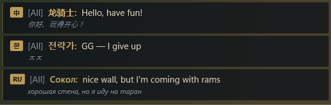
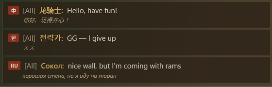
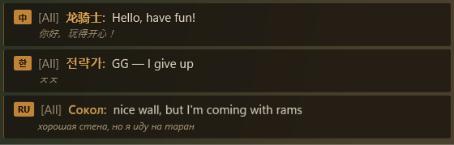

# Theming

Every pixel of Envoy's UI (settings, overlay, reply box and region picker) is drawn from one palette dictionary
plus a shared control library. Switching theme swaps the palette at runtime. Every control uses `DynamicResource`,
so the change is instant.

## The themes

| Id | Name | Inspired by | Feel |
| --- | --- | --- | --- |
| `imperial` | Imperial | Age of Empires IV | Midnight blue, burnished gold |
| `parchment` | Parchment | Age of Empires II | Illuminated vellum, oak, rubric red |
| `frontier` | Frontier | Age of Empires III | Deep teal charts, brass |
| `olympian` | Olympian | Age of Mythology | Aegean blue, bronze, marble |
| `classic` | Classic | Age of Empires | Sandstone and bronze-age earth |

**Match the game** (the default) picks the theme of the running game.

A sixth palette, `highcontrast`, is not in the picker: Envoy switches to it when a Windows contrast theme is on
(Appearance › Accessibility › High contrast: **Follow Windows**, the default), or always with **Always**. Its colours
are Windows' own system colours (`SystemColors`), read when the palette loads, so Envoy reloads it whenever the
contrast theme changes.

| Imperial | Parchment | Classic |
| --- | --- | --- |
|  |  |  |

Fresh renders of every window in every theme are pushed to the `ci-screenshots` branch on each build of `main`.

All the decoration is original: gilded rules, diamond studs at frame corners, a diamond slider thumb, and Cinzel
(an open-licence font modelled on Roman inscriptions) for headings. No game assets, logos or fonts are used.

## Palette keys

Each `Themes/Palette.<id>.xaml` defines the same keys. CI and `tools/typecheck/typecheck.sh` fail if they drift
apart.

| Key | Used for |
| --- | --- |
| `Bg.Window`, `Bg.Panel`, `Bg.PanelAlt`, `Bg.Input` | Window, cards, raised surfaces, text inputs |
| `Accent`, `Accent.Bright`, `Accent.Dim` | Gold/brass trim, highlights, subtle rules |
| `Accent.Gradient`, `Header.Gradient`, `Rule.Gradient` | Primary buttons, title bar, flourish dividers |
| `Text.Primary`, `Text.Secondary`, `Text.Muted`, `Text.OnAccent` | Text hierarchy; text on accent fills |
| `Border.Subtle` | Hairlines and input borders |
| `Danger`, `Success` | Errors and confirmations |
| `Overlay.Bg`, `Overlay.Text`, `Overlay.Sender`, `Overlay.Original` | The in-game overlay (its card alpha comes from settings and the readable-text floor) |
| `Focus.Ring` | The keyboard focus ring (`FocusVisual.Ring`) and focused borders |
| `Overlay.HitTest`, `Overlay.Dim` | The region selector's near-invisible hit-test surface and dimmed screen. Functional, not decorative: `#01000000` and `#99000000` in every palette, including high contrast |

Every brush also has a matching `*.Color` resource.

### Contrast rules

`PaletteContrastTests` (Core unit tests) read every `Palette.*.xaml` except `highcontrast` and fail the build unless:

- `Text.Primary`, `Text.Secondary`, `Text.Muted` and `Danger` reach **4.5:1** against `Bg.Window`, `Bg.Panel`,
  `Bg.PanelAlt` and `Bg.Input`;
- `Focus.Ring` reaches **3:1** against the same four backgrounds (use the palette's `Accent.Bright` if it passes);
- `Overlay.Text` and `Overlay.Sender` reach **4.5:1** against an opaque `Overlay.Bg`.

With **Keep text readable** on, the overlay card alpha is never lower than
`ContrastMath.MinimumBackgroundAlpha(Overlay.Text, Overlay.Bg, 4.5)` over white, grey and black backdrops.

No window, page or control XAML may use a literal colour (`#…`); `tools/typecheck/check_a11y.py` enforces this,
along with a focus visual on every focusable style and an accessible name on every interactive control.

## Adding a theme

1. Copy `src/Envoy.App/Themes/Palette.imperial.xaml` to `Palette.<your-id>.xaml` and change the colours.
2. Add a `ThemeInfo` to `ThemeManager.Themes` and swatches to `MainViewModel.SwatchesFor`.
3. Optionally make it a game's default in `GameCatalog` (`ThemeId`).
4. Run `tools/typecheck/typecheck.sh` (or let CI run the smoke test, which builds every window under every theme).

`PaletteContrastTests` covers a new palette automatically; fix any colour it reports. Check contrast on the overlay
in particular. It's read at a glance over busy game scenery, so keep `Overlay.Text`
near white (or near black on a light theme) with a solid enough background.

## Shared styles

`Themes/Controls.xaml` holds keyed styles you can use in new windows:

- Text: `Text.H1`, `Text.H2`, `Text.Label`, `Text.Body`, `Text.Caption`, `Text.Icon`
- Containers: `OrnateFrame` (a `ContentControl` with double rules and corner studs), `Flourish` (a divider)
- Buttons: the default style, `Button.Primary`, `Button.Ghost`, `Button.Chip`, `Button.Chrome`
- Navigation: `NavItem`, `ThemeCard`
- Focus: `FocusVisual.Ring` (set it as `FocusVisualStyle` on any new focusable style; never `{x:Null}`)
- Implicit styles for `TextBox`, `PasswordBox`, `ComboBox`, `CheckBox` (a toggle switch), `Slider`, `ScrollBar`
  and `ToolTip`
